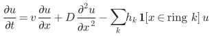
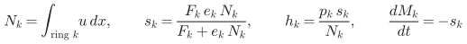
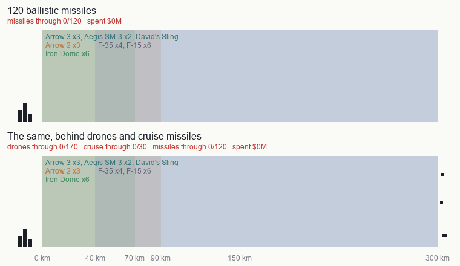
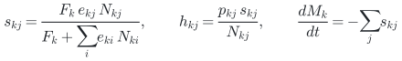
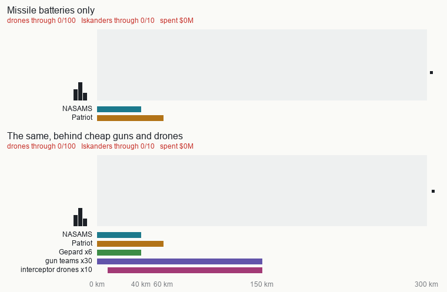
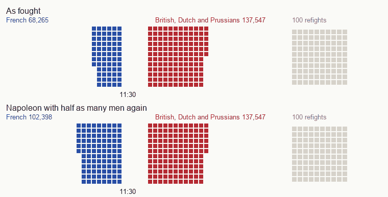

# Jomini

[](https://github.com/umitkaanusta/Jomini/actions/workflows/ci.yml)
[](LICENSE)

**Simulate battles from the musket to the drone.**

Jomini provides models of attrition and escalation, and lets you fit them to historical
battles and, where data exists, to wars still being fought.

It also runs as an [MCP server for your AI agents](#use-it-from-claude). The Python package
on PyPI is out of date; I'll update it once my PyPI account is unblocked.

We don't celebrate or glorify war or any other violence. Jomini is for studying how wars
are fought today and how they were fought in the past.

## Simulating a drone raid


Two drone raids, one of 30 drones and one of 500, fly at a city by night. Three rings of
defence stand in their way: interceptor drones far out, mobile gun teams closer in, and
surface-to-air missiles around the city.

The simulation uses a model of drone swarms against layered air defence by Charles
Randow, Ryan Allaire and Antonio Mastroberardino (2026). It treats the swarm as a cloud
of drones that flows toward the target and thins out as each ring fires into it.

We fitted the model to 778 nights of Ukrainian Air Force reports, from September 2024 to
November 2026. The fitted defence stops three drones in four from the small raid, and
more than nine in ten from the big one.

<details>
<summary>The equations and the fit</summary>

**The equations**

Each ring is one kind of equipment, with its own range, chance to kill, rate of fire,
stock of ammunition and cost per shot. In the demo:

```
city <-- missiles --|-- mobile guns --|-- interceptor drones --|<-- raid
0 km              40 km            150 km                   300 km
```

Let <i>u</i>(<i>x</i>, <i>t</i>) be the number of drones per kilometre at distance <i>x</i> from the city. They
fly in at speed <i>v</i> and spread out as they go. Ring <i>k</i> kills them at rate <i>h</i><sub>k</sub>:

<picture>
  <source media="(prefers-color-scheme: dark)" srcset="docs/eq/raid-dark.svg">
  
</picture>

Ring <i>k</i> has <i>N</i><sub>k</sub> drones inside it and fires <i>s</i><sub>k</sub> shots an hour, until its stock <i>M</i><sub>k</sub>
runs out:

<picture>
  <source media="(prefers-color-scheme: dark)" srcset="docs/eq/rings-dark.svg">
  
</picture>

When a big raid is coming, the defence can be reinforced. For a raid of <i>R</i> drones, <i>F</i><sub>k</sub>
and <i>e</i><sub>k</sub> are multiplied by (<i>R</i>/100)<sup>σ</sup>. Drones that reach <i>x</i> = 0 get through.

| Symbol | Meaning |
|---|---|
| <i>v</i> | Drone speed (185 km/h) |
| <i>D</i> | How fast the raid spreads out (50 km²/h) |
| <i>p</i><sub>k</sub> | Chance that one shot kills |
| <i>e</i><sub>k</sub> | How often a lone drone is shot at (shots per hour) |
| <i>F</i><sub>k</sub> | The most shots the ring can fire in an hour |
| <i>M</i><sub>k</sub> | Shots left in stock |
| σ | Surge: how much the defence is reinforced for big raids |

**What it means**

- **Few drones:** every drone runs the same risk, <i>h</i><sub>k</sub> = <i>p</i><sub>k</sub> <i>e</i><sub>k</sub>. Numbers don't help the
  attacker.
- **Many drones:** the ring fires flat out, so each drone's risk falls as <i>p</i><sub>k</sub> <i>F</i><sub>k</sub>/<i>N</i><sub>k</sub>.
  Numbers swamp the defence.

So a defence that can't reinforce lets a bigger share through as raids grow. If big raids
leak a smaller share, the defence must be reinforcing (σ > 0).

**Fitted to Ukraine's data**

Each night the Ukrainian Air Force reports how many drones were launched and how many
were stopped. Jomini downloads these reports, compiled by Petro Ivaniuk, when you use
them. The fit uses 778 nights with at least five drones launched, and compares each night
with the typical raid that month (125 drones).

| Parameter | Estimate |
|---|---|
| Chance one shot kills (drones, guns, missiles) | 0.63, 0.32, 0.90 |
| Surge, σ | 0.19: when a raid doubles, each drone is shot at 14% more often |
| Most shots per hour, <i>F</i><sub>k</sub> | never reached on a typical night |
| Stock, <i>M</i><sub>k</sub> | doesn't run out within a night |

| Raid size | Got through (data) | Model |
|---|---|---|
| ¼ of typical | 16.5% | 23.5% |
| ½ | 19.7% | 19.2% |
| typical | 16.1% | 15.5% |
| 2× | 11.2% | 11.9% |
| 4× | 8.5% | 8.5% |

**Why do small raids get through more often?** A big raid is spotted early, and more of
the defence turns out for it: more gun teams, more interceptors in the air. A small raid
meets whatever is on duty that night. In the model this is the surge: when a raid
doubles, each drone is shot at about 14% more often.

**Reproduce it**

```bash
uv sync --all-extras
uv run python scripts/fit_ukraine_defense.py
uv run python scripts/make_raid_gif.py
```

</details>

## A missile and drone strike



A hundred ballistic missiles fly at a city. In the top run they come alone. In the bottom
run, 150 drones are sent first, timed to reach the city just before the missiles, as in
the mass strikes of the Iran–Israel wars. Three rings defend the city: fighters that hunt
drones far out, an upper tier that shoots only at missiles, and a lower tier near the city
that shoots at both.

The model is the drone raid model, extended so that drones and missiles share the
defence. A ring splits its fire between the attackers inside it in proportion to their
numbers, a rule from C. S. Holling's work on predators and prey (1959).

Alone, 6 missiles in 100 get through. Behind the drones, 33 do: the drones use up the
lower tier's interceptors before the missiles arrive.

<details>
<summary>The equations and the numbers</summary>

Each wave <i>j</i> (drones, missiles) has its own density <i>u</i><sub>j</sub>(<i>x</i>, <i>t</i>) and speed <i>v</i><sub>j</sub>, and
follows the same equation as the drone raid. Ring <i>k</i> fires at all the waves it can
engage and splits its shots between them:

<picture>
  <source media="(prefers-color-scheme: dark)" srcset="docs/eq/strike-dark.svg">
  
</picture>

<i>N</i><sub>kj</sub> is the number of wave <i>j</i> inside ring <i>k</i>, and <i>p</i><sub>kj</sub> is the ring's chance of
killing one of them with one shot (0 if it can't engage them). Every shot, at a drone or
a missile, comes out of the same stock <i>M</i><sub>k</sub>.

| Ring | Range | Engages | Chance one shot kills | Interceptors |
|---|---|---|---|---|
| Fighters | 300–120 km | drones | 0.6 | unlimited |
| Upper tier | 120–40 km | missiles | 0.8 | 70 |
| Lower tier | 40–0 km | both | 0.7 | 90 |

The drones fly at 185 km/h and arrive over an hour. The missiles fly at 7,000 km/h and
arrive within six minutes, two hours after the first drones.

These numbers are made up to show the mechanism. There is too little public data on
single strikes to fit them.

**Reproduce it**

```bash
uv sync --all-extras
uv run python scripts/make_strike_gif.py
```

</details>

## Cheap guns protect expensive missiles



A hundred Shahed drones fly at a city over an hour and a half. Ten Iskander ballistic
missiles follow an hour later. In the top run the city has only missile batteries, a
NASAMS and a Patriot, and with nothing else to stop the drones they fire at them too. In
the bottom run the same batteries stand behind six Gepard guns, 30 mobile gun teams and
ten teams of interceptor drones.

Both defences are built from Jomini's equipment catalogue (below) and run on the same
model as the strike above.

Alone, the missile batteries fire all 66 of their interceptors, worth $210 million, at
drones worth $3.5 million. A third of the drones still get through, and so do all ten
Iskanders. Behind the cheap layers almost no drone gets through, the batteries still
have 14 interceptors when the missiles arrive, and six Iskanders in ten are stopped.

<details>
<summary>The code and the numbers</summary>

```python
from jomini import equipment as eq
from jomini.airdefense import AirDefense

strike = [
    eq.wave("Shahed-136", 100, launch_window=1.5),
    eq.wave("Iskander-M", 10, launch_at=2.5, launch_window=0.05),
]
batteries = [eq.layer("NASAMS", targets="all"), eq.layer("Patriot PAC-3", targets="all")]
cheap = [
    eq.layer("Gepard", 6),
    eq.layer("mobile gun team", 30),
    eq.layer("interceptor drone team", 10),
]

AirDefense(tuple(batteries), edge=300).strike(strike)
# Shahed-136: 34.7 of 100 through (34.7%); Iskander-M: 10.0 of 10 through (100.0%)
AirDefense((*batteries, *cheap), edge=300).strike(strike)
# Shahed-136: 0.5 of 100 through (0.5%); Iskander-M: 3.8 of 10 through (37.8%)
```

`targets="all"` makes the batteries fire at drones too. By default, medium- and
long-range missile systems hold fire on slow drones and leave them to cheaper weapons.

| System | Where it fires | Shots | Cost per shot |
|---|---|---|---|
| NASAMS | 0–40 km | 18 | $1,000,000 |
| Patriot PAC-3 | 0–60 km | 48 | $4,000,000 |
| Gepard (×6) | 0–40 km | 30 bursts each | $3,000 |
| Mobile gun team (×30) | 0–150 km, along the routes | unlimited | $300 |
| Interceptor drone team (×10) | 10–150 km | 10 each | $3,000 |

**Reproduce it**

```bash
uv sync --all-extras
uv run python scripts/make_layers_gif.py
```

</details>

## Waterloo, with a bigger French army



**Note:** As a Napoleon admirer, I think he would have done better.

Waterloo, 18 June 1815. Napoleon attacked with 68,000 men. Against him stood 138,000
British, Dutch and Prussian troops, counted together. The top run replays the battle as
fought. The bottom run gives Napoleon half as many men again: 102,000.

Losses follow Frederick Lanchester's equations of attrition (1916), fitted to the real
casualties. Each army breaks when its losses reach a level learned from 660 battles
fought between 1600 and 1982, following Robert Helmbold's work on breaking points
(1971).

As fought, the French break at about seven in the evening, close to when the Imperial
Guard's attack failed on the day. Napoleon wins 27 refights in 100. With half as many men
again he wins 37. More men help, but he still loses most of the time.

<details>
<summary>The equations and the numbers</summary>

<i>R</i> and <i>B</i> are the French and allied armies. Each side's losses grow with both armies'
sizes:

<picture>
  <source media="(prefers-color-scheme: dark)" srcset="docs/eq/waterloo-dark.svg">
  
</picture>

Fitted to the real casualties (25,000 French, 22,500 allied in half a day), a French
soldier was 0.9 times as deadly as an allied one (ρ/β).

An army breaks once it has lost a share <i>b</i> of its men, where log <i>b</i> is normally
distributed. Fitted to 660 battles, the median for 1815 is 25% for an attacker and 27%
for a defender. Each refight draws new breaking points for both sides.

This uses the linear form of Lanchester's equations, which fits the 660 battles best.
Under the square form, where numbers count for more, the bigger French army would win
53 refights in 100.

**Reproduce it**

```bash
uv sync --all-extras
uv run python scripts/make_waterloo_gif.py
```

</details>

## Pick your equipment

Instead of typing in numbers, build a defence and a strike from named systems:

```python
from jomini import equipment as eq

city = {"Patriot PAC-3": 1, "IRIS-T SLM": 1, "Gepard": 4, "F-16": 2, "mobile gun team": 30}
strike = [
    eq.wave("Shahed-136", 300, launch_window=2),  # 300 drones over two hours
    eq.wave("Kh-101", 20, launch_at=1, launch_window=0.5),  # cruise missiles an hour later
    eq.wave("Iskander-M", 8, launch_at=2.5),  # ballistic missiles at the end
]
print(eq.defense(city).strike(strike))
# Shahed-136: 154.0 of 300 through (51.3%); Kh-101: 7.6 of 20 through (38.1%);
# Iskander-M: 5.4 of 8 through (68.0%)
```

The catalogue has 102 attackers (drones, cruise, ballistic and hypersonic missiles, glide
bombs, rockets, strike aircraft) and 77 defences (guns, interceptor drones, jamming,
fighters, lasers, and short-, medium- and long-range missile systems). Speeds, ranges,
magazine sizes and costs are rounded public figures.

> **How far to trust the numbers.** Kill chances aren't public. They are rough defaults
> for each class of system, not any system's real performance. Kill chances against
> drones and cruise missiles are tuned so that a Ukraine-like city defence stops the
> share Ukraine reports (87% and 78%). Ballistic missiles aren't tuned: Ukraine stops
> about a quarter of them nationally, but most hit places without Patriot cover, so that
> figure is about coverage, not about Patriot. Strikes like Iran's on Israel come out
> worse for the defender than they really were. The model doesn't know that many
> missiles fail on their own, or that defenders let missiles heading for empty ground
> fall.

<details>
<summary>Attackers</summary>

| Name | Class | From | Speed (km/h) | Range (km) |
|---|---|---|---|---|
| Shahed-136 | loitering drone | Iran | 185 | 2,000 |
| Shahed-131 | loitering drone | Iran | 180 | 900 |
| Lancet-3 | loitering drone | Russia | 110 | 70 |
| Shahed-107 | loitering drone | Iran | 160 | 1,500 |
| Arash-2 | loitering drone | Iran | 185 | 2,000 |
| Harop | loitering drone | Israel | 185 | 1,000 |
| Switchblade 600 | loitering drone | United States | 185 | 40 |
| Kargu-2 | loitering drone | Turkey | 145 | 10 |
| Liutyi | loitering drone | Ukraine | 150 | 2,000 |
| UJ-22 Airborne | loitering drone | Ukraine | 160 | 800 |
| Bober | loitering drone | Ukraine | 150 | 1,000 |
| Samad-3 | loitering drone | Houthis (Yemen) | 200 | 1,500 |
| Shahed-238 | jet drone | Iran | 550 | 1,500 |
| Bayraktar Kizilelma | jet drone | Turkey | 900 | 900 |
| Gerbera | decoy drone | Russia | 160 | 600 |
| Orlan-10 | decoy drone | Russia | 120 | 120 |
| Bayraktar TB2 | combat drone | Turkey | 130 | 300 |
| Bayraktar Akinci | combat drone | Turkey | 250 | 6,000 |
| Wing Loong II | combat drone | China | 280 | 4,000 |
| CH-4 | combat drone | China | 180 | 3,500 |
| CH-5 | combat drone | China | 220 | 6,500 |
| Mohajer-6 | combat drone | Iran | 180 | 2,000 |
| MQ-9 Reaper | combat drone | United States | 310 | 1,800 |
| TAI Anka | combat drone | Turkey | 200 | 2,500 |
| Hermes 900 | combat drone | Israel | 220 | 2,000 |
| Heron TP | combat drone | Israel | 300 | 7,400 |
| Orion | combat drone | Russia | 200 | 1,000 |
| Kh-101 | cruise missile | Russia | 750 | 2,800 |
| Kalibr | cruise missile | Russia | 800 | 1,500 |
| Iskander-K | cruise missile | Russia | 850 | 500 |
| Kh-59 | cruise missile | Russia | 1,000 | 290 |
| Tomahawk | cruise missile | United States | 880 | 1,600 |
| Storm Shadow | cruise missile | UK / France | 1,000 | 550 |
| Taurus KEPD 350 | cruise missile | Germany / Sweden | 1,100 | 500 |
| Paveh | cruise missile | Iran | 800 | 1,650 |
| CJ-10 | cruise missile | China | 800 | 1,500 |
| Kh-55 | cruise missile | Soviet Union | 800 | 2,500 |
| Neptune | cruise missile | Ukraine | 900 | 300 |
| Long Neptune | cruise missile | Ukraine | 900 | 1,000 |
| Flamingo | cruise missile | Ukraine | 900 | 3,000 |
| JASSM-ER | cruise missile | United States | 1,000 | 925 |
| Harpoon | cruise missile | United States | 860 | 280 |
| Exocet | cruise missile | France | 1,100 | 180 |
| Hoveyzeh | cruise missile | Iran | 800 | 1,350 |
| Quds-1 | cruise missile | Houthis (Yemen) | 750 | 1,300 |
| Kh-35 | cruise missile | Russia | 950 | 260 |
| Kh-22 | supersonic missile | Russia | 4,000 | 600 |
| P-800 Oniks | supersonic missile | Russia | 3,000 | 600 |
| BrahMos | supersonic missile | India / Russia | 3,400 | 450 |
| Kh-31 | supersonic missile | Russia | 3,000 | 110 |
| YJ-12 | supersonic missile | China | 3,500 | 400 |
| YJ-18 | supersonic missile | China | 3,000 | 540 |
| Iskander-M | ballistic missile | Russia | 6,500 | 500 |
| KN-23 | ballistic missile | North Korea | 6,500 | 700 |
| Fateh-110 | ballistic missile | Iran | 4,500 | 300 |
| ATACMS | ballistic missile | United States | 3,600 | 300 |
| DF-15 | ballistic missile | China | 6,000 | 600 |
| Tochka-U | ballistic missile | Soviet Union | 4,000 | 120 |
| S-300 (ground attack) | ballistic missile | Russia | 4,500 | 150 |
| Zolfaghar | ballistic missile | Iran | 5,500 | 700 |
| Dezful | ballistic missile | Iran | 6,000 | 1,000 |
| Burkan-3 | ballistic missile | Houthis (Yemen) | 6,000 | 1,200 |
| PrSM | ballistic missile | United States | 5,000 | 500 |
| Hrim-2 | ballistic missile | Ukraine | 6,000 | 500 |
| DF-11 | ballistic missile | China | 5,500 | 300 |
| Emad | medium-range ballistic missile | Iran | 10,000 | 1,700 |
| Ghadr | medium-range ballistic missile | Iran | 10,000 | 1,950 |
| Kheibar Shekan | medium-range ballistic missile | Iran | 10,000 | 1,450 |
| Sejjil | medium-range ballistic missile | Iran | 11,000 | 2,000 |
| DF-21 | medium-range ballistic missile | China | 11,000 | 1,700 |
| Shahab-3 | medium-range ballistic missile | Iran | 9,000 | 1,300 |
| Khorramshahr | medium-range ballistic missile | Iran | 11,000 | 2,000 |
| Haj Qasem | medium-range ballistic missile | Iran | 10,000 | 1,400 |
| Palestine-2 | medium-range ballistic missile | Houthis (Yemen) | 10,000 | 2,150 |
| DF-26 | medium-range ballistic missile | China | 12,000 | 4,000 |
| 3M22 Zircon | hypersonic missile | Russia | 7,000 | 1,000 |
| Kinzhal | hypersonic missile | Russia | 8,000 | 2,000 |
| Fattah-1 | hypersonic missile | Iran | 9,000 | 1,400 |
| DF-17 | hypersonic missile | China | 9,000 | 2,000 |
| Fattah-2 | hypersonic missile | Iran | 9,000 | 1,500 |
| Oreshnik | hypersonic missile | Russia | 12,000 | 5,000 |
| F-16 (strike) | strike aircraft | United States | 900 | 550 |
| Su-34 | strike aircraft | Russia | 900 | 1,100 |
| F-15E | strike aircraft | United States | 950 | 1,300 |
| Su-25 | strike aircraft | Soviet Union | 750 | 500 |
| Su-24 | strike aircraft | Soviet Union | 900 | 600 |
| Rafale (strike) | strike aircraft | France | 950 | 1,800 |
| GJ-11 | stealth aircraft | China | 800 | 1,500 |
| F-35 (strike) | stealth aircraft | United States | 900 | 1,100 |
| J-20 | stealth aircraft | China | 1,000 | 1,100 |
| B-2 | stealth aircraft | United States | 900 | 11,000 |
| Su-57 | stealth aircraft | Russia | 1,000 | 1,500 |
| J-35 | stealth aircraft | China | 1,000 | 1,200 |
| F-22 (strike) | stealth aircraft | United States | 1,000 | 850 |
| KAB with UMPK | glide bomb | Russia | 700 | 70 |
| JDAM-ER | glide bomb | United States | 700 | 70 |
| GBU-39 SDB | glide bomb | United States | 700 | 110 |
| Grad | rocket | Soviet Union | 2,500 | 40 |
| Qassam | rocket | Gaza | 1,500 | 15 |
| Fajr-5 | rocket | Iran | 3,000 | 75 |
| Smerch | rocket | Soviet Union | 3,500 | 90 |
| GMLRS | rocket | United States | 3,500 | 80 |

</details>

<details>
<summary>Defences</summary>

Medium- and long-range missile systems hold fire on slow drones unless told otherwise.

| Name | Class | From | Range (km) | Shots per unit | Can hit |
|---|---|---|---|---|---|
| mobile gun team | gun team | generic | 2 | unlimited | drones, jet drones, decoys, combat drones, cruise |
| Gepard | anti-aircraft gun | Germany | 5.5 | 30 | drones, jet drones, decoys, combat drones, cruise, rockets |
| Skynex | anti-aircraft gun | Germany | 4 | 40 | drones, jet drones, decoys, combat drones, cruise, rockets |
| Phalanx | anti-aircraft gun | United States | 3.5 | 15 | drones, jet drones, decoys, combat drones, cruise, rockets |
| ZU-23-2 | anti-aircraft gun | Soviet Union | 2.5 | 40 | drones, jet drones, decoys, combat drones, cruise, rockets |
| Shilka | anti-aircraft gun | Soviet Union | 2.5 | 30 | drones, jet drones, decoys, combat drones, cruise, rockets |
| Skyranger 30 | anti-aircraft gun | Germany | 3 | 40 | drones, jet drones, decoys, combat drones, cruise, rockets |
| Korkut | anti-aircraft gun | Turkey | 4 | 40 | drones, jet drones, decoys, combat drones, cruise, rockets |
| Type 1130 | anti-aircraft gun | China | 3.5 | 20 | drones, jet drones, decoys, combat drones, cruise, rockets |
| interceptor drone team | interceptor drone | Ukraine | 25 | 10 | drones, jet drones, decoys, combat drones |
| Coyote | interceptor drone | United States | 15 | 8 | drones, jet drones, decoys, combat drones |
| Merops | interceptor drone | United States | 20 | 10 | drones, jet drones, decoys, combat drones |
| jamming | jamming | generic | 30 | unlimited | drones, jet drones, decoys, combat drones |
| F-16 | fighter | United States | 550 | 8 | drones, jet drones, decoys, combat drones, cruise, supersonic, aircraft, stealth, glide bombs |
| F-15 | fighter | United States | 1200 | 10 | drones, jet drones, decoys, combat drones, cruise, supersonic, aircraft, stealth, glide bombs |
| F-35 | fighter | United States | 1100 | 6 | drones, jet drones, decoys, combat drones, cruise, supersonic, aircraft, stealth, glide bombs |
| Eurofighter Typhoon | fighter | UK / Germany / Italy / Spain | 1400 | 8 | drones, jet drones, decoys, combat drones, cruise, supersonic, aircraft, stealth, glide bombs |
| Rafale | fighter | France | 1800 | 8 | drones, jet drones, decoys, combat drones, cruise, supersonic, aircraft, stealth, glide bombs |
| Mirage 2000 | fighter | France | 1500 | 6 | drones, jet drones, decoys, combat drones, cruise, supersonic, aircraft, stealth, glide bombs |
| Su-35 | fighter | Russia | 1600 | 10 | drones, jet drones, decoys, combat drones, cruise, supersonic, aircraft, stealth, glide bombs |
| J-10C | fighter | China | 1200 | 8 | drones, jet drones, decoys, combat drones, cruise, supersonic, aircraft, stealth, glide bombs |
| J-16 | fighter | China | 1500 | 10 | drones, jet drones, decoys, combat drones, cruise, supersonic, aircraft, stealth, glide bombs |
| MiG-29 | fighter | Soviet Union | 700 | 6 | drones, jet drones, decoys, combat drones, cruise, supersonic, aircraft, stealth, glide bombs |
| Su-27 | fighter | Soviet Union | 1300 | 8 | drones, jet drones, decoys, combat drones, cruise, supersonic, aircraft, stealth, glide bombs |
| Gripen | fighter | Sweden | 800 | 8 | drones, jet drones, decoys, combat drones, cruise, supersonic, aircraft, stealth, glide bombs |
| F/A-18 | fighter | United States | 750 | 8 | drones, jet drones, decoys, combat drones, cruise, supersonic, aircraft, stealth, glide bombs |
| Yak-52 | helicopter | Soviet Union | 20 | unlimited | drones, jet drones, decoys, combat drones |
| Mi-8 / Mi-24 | helicopter | Soviet Union | 100 | unlimited | drones, jet drones, decoys, combat drones |
| AH-64 Apache | helicopter | United States | 400 | unlimited | drones, jet drones, decoys, combat drones |
| Iron Beam | laser | Israel | 10 | unlimited | drones, jet drones, decoys, combat drones, rockets |
| DragonFire | laser | UK | 5 | unlimited | drones, jet drones, decoys, combat drones, rockets |
| Tryzub | laser | Ukraine | 5 | unlimited | drones, jet drones, decoys, combat drones, rockets |
| Leonidas | microwave | United States | 1 | unlimited | drones, decoys |
| Iron Dome | short-range SAM | Israel | 70 | 60 | drones, jet drones, decoys, combat drones, cruise, supersonic, aircraft, stealth, glide bombs, rockets |
| IRIS-T SLS | short-range SAM | Germany | 12 | 8 | drones, jet drones, decoys, combat drones, cruise, supersonic, aircraft, stealth, glide bombs, rockets |
| Stinger (Avenger) | short-range SAM | United States | 8 | 8 | drones, jet drones, decoys, combat drones, cruise, supersonic, aircraft, stealth, glide bombs, rockets |
| Pantsir-S1 | short-range SAM | Russia | 20 | 12 | drones, jet drones, decoys, combat drones, cruise, supersonic, aircraft, stealth, glide bombs, rockets |
| Tor-M2 | short-range SAM | Russia | 16 | 16 | drones, jet drones, decoys, combat drones, cruise, supersonic, aircraft, stealth, glide bombs, rockets |
| HQ-17 | short-range SAM | China | 15 | 16 | drones, jet drones, decoys, combat drones, cruise, supersonic, aircraft, stealth, glide bombs, rockets |
| Strela-10 | short-range SAM | Soviet Union | 5 | 8 | drones, jet drones, decoys, combat drones, cruise, supersonic, aircraft, stealth, glide bombs, rockets |
| Osa | short-range SAM | Soviet Union | 10 | 6 | drones, jet drones, decoys, combat drones, cruise, supersonic, aircraft, stealth, glide bombs, rockets |
| Tunguska | short-range SAM | Soviet Union | 10 | 8 | drones, jet drones, decoys, combat drones, cruise, supersonic, aircraft, stealth, glide bombs, rockets |
| Piorun | short-range SAM | Poland | 6 | 8 | drones, jet drones, decoys, combat drones, cruise, supersonic, aircraft, stealth, glide bombs, rockets |
| Starstreak | short-range SAM | UK | 7 | 8 | drones, jet drones, decoys, combat drones, cruise, supersonic, aircraft, stealth, glide bombs, rockets |
| Crotale | short-range SAM | France | 11 | 8 | drones, jet drones, decoys, combat drones, cruise, supersonic, aircraft, stealth, glide bombs, rockets |
| VL MICA | short-range SAM | France | 20 | 16 | drones, jet drones, decoys, combat drones, cruise, supersonic, aircraft, stealth, glide bombs, rockets |
| Hisar-A | short-range SAM | Turkey | 15 | 16 | drones, jet drones, decoys, combat drones, cruise, supersonic, aircraft, stealth, glide bombs, rockets |
| Spyder | short-range SAM | Israel | 20 | 16 | drones, jet drones, decoys, combat drones, cruise, supersonic, aircraft, stealth, glide bombs, rockets |
| SeaRAM | short-range SAM | United States | 9 | 11 | drones, jet drones, decoys, combat drones, cruise, supersonic, aircraft, stealth, glide bombs, rockets |
| HQ-7 | short-range SAM | China | 12 | 16 | drones, jet drones, decoys, combat drones, cruise, supersonic, aircraft, stealth, glide bombs, rockets |
| NASAMS | medium-range SAM | Norway / United States | 40 | 18 | drones, jet drones, decoys, combat drones, cruise, supersonic, ballistic, aircraft, stealth, glide bombs, rockets |
| IRIS-T SLM | medium-range SAM | Germany | 40 | 24 | drones, jet drones, decoys, combat drones, cruise, supersonic, ballistic, aircraft, stealth, glide bombs, rockets |
| David's Sling | medium-range SAM | Israel / United States | 300 | 32 | drones, jet drones, decoys, combat drones, cruise, supersonic, ballistic, aircraft, stealth, glide bombs, rockets |
| Buk-M2 | medium-range SAM | Russia | 45 | 16 | drones, jet drones, decoys, combat drones, cruise, supersonic, ballistic, aircraft, stealth, glide bombs, rockets |
| HQ-16 | medium-range SAM | China | 40 | 18 | drones, jet drones, decoys, combat drones, cruise, supersonic, ballistic, aircraft, stealth, glide bombs, rockets |
| Hisar-O | medium-range SAM | Turkey | 25 | 16 | drones, jet drones, decoys, combat drones, cruise, supersonic, ballistic, aircraft, stealth, glide bombs, rockets |
| Barak MX | medium-range SAM | Israel | 150 | 24 | drones, jet drones, decoys, combat drones, cruise, supersonic, ballistic, aircraft, stealth, glide bombs, rockets |
| KM-SAM | medium-range SAM | South Korea | 40 | 24 | drones, jet drones, decoys, combat drones, cruise, supersonic, ballistic, aircraft, stealth, glide bombs, rockets |
| Hawk | medium-range SAM | United States | 45 | 18 | drones, jet drones, decoys, combat drones, cruise, supersonic, ballistic, aircraft, stealth, glide bombs, rockets |
| Aster 15 | medium-range SAM | France / Italy | 30 | 16 | drones, jet drones, decoys, combat drones, cruise, supersonic, ballistic, aircraft, stealth, glide bombs, rockets |
| ESSM | medium-range SAM | United States | 50 | 32 | drones, jet drones, decoys, combat drones, cruise, supersonic, ballistic, aircraft, stealth, glide bombs, rockets |
| S-350 Vityaz | medium-range SAM | Russia | 60 | 48 | drones, jet drones, decoys, combat drones, cruise, supersonic, ballistic, aircraft, stealth, glide bombs, rockets |
| SAMP/T | long-range SAM | France / Italy | 120 | 48 | drones, jet drones, decoys, combat drones, cruise, supersonic, ballistic, MRBM, hypersonic, aircraft, stealth, glide bombs, rockets |
| Patriot PAC-3 | long-range SAM | United States | 60 | 48 | drones, jet drones, decoys, combat drones, cruise, supersonic, ballistic, MRBM, hypersonic, aircraft, stealth, glide bombs, rockets |
| Patriot PAC-2 | long-range SAM | United States | 160 | 16 | drones, jet drones, decoys, combat drones, cruise, supersonic, ballistic, MRBM, hypersonic, aircraft, stealth, glide bombs, rockets |
| S-400 | long-range SAM | Russia | 250 | 32 | drones, jet drones, decoys, combat drones, cruise, supersonic, ballistic, MRBM, hypersonic, aircraft, stealth, glide bombs, rockets |
| S-300 | long-range SAM | Soviet Union | 150 | 32 | drones, jet drones, decoys, combat drones, cruise, supersonic, ballistic, MRBM, hypersonic, aircraft, stealth, glide bombs, rockets |
| HQ-9 | long-range SAM | China | 200 | 32 | drones, jet drones, decoys, combat drones, cruise, supersonic, ballistic, MRBM, hypersonic, aircraft, stealth, glide bombs, rockets |
| Siper | long-range SAM | Turkey | 100 | 24 | drones, jet drones, decoys, combat drones, cruise, supersonic, ballistic, MRBM, hypersonic, aircraft, stealth, glide bombs, rockets |
| SAMP/T NG | long-range SAM | France / Italy | 150 | 48 | drones, jet drones, decoys, combat drones, cruise, supersonic, ballistic, MRBM, hypersonic, aircraft, stealth, glide bombs, rockets |
| HQ-22 | long-range SAM | China | 170 | 24 | drones, jet drones, decoys, combat drones, cruise, supersonic, ballistic, MRBM, hypersonic, aircraft, stealth, glide bombs, rockets |
| THAAD | upper-tier missile defence | United States | 200 | 48 | ballistic, MRBM, hypersonic |
| Arrow 2 | upper-tier missile defence | Israel / United States | 90 | 24 | ballistic, MRBM, hypersonic |
| Arrow 3 | upper-tier missile defence | Israel / United States | 2400 | 24 | ballistic, MRBM, hypersonic |
| S-500 | upper-tier missile defence | Russia | 600 | 16 | ballistic, MRBM, hypersonic |
| Aegis destroyer (SM-3) | upper-tier missile defence | United States | 700 | 8 | ballistic, MRBM, hypersonic |
| Aegis destroyer (SM-2/SM-6) | naval air defence | United States | 240 | 40 | drones, jet drones, decoys, combat drones, cruise, supersonic, ballistic, MRBM, hypersonic, aircraft, stealth, glide bombs |

</details>

## What it lacks

- **Space.** No maps, terrain or routes. The raid model knows only how far each drone is
  from its target.
- **Everything but attrition.** No manoeuvre, morale, command, supply or weather, except
  that a side can break after heavy losses.
- **Real orders of battle.** Ranges, weapon numbers and costs are placeholders.
- **Decoys and jamming.** They show up only as drones that never arrive.
- **Forecasts.** The fits describe what happened. They don't predict what will.

## Other models

- **Escalation:** how much violence in a war feeds on itself, from UCDP's 418,000 events
  since 1989. In Russia–Ukraine each event sets off 0.69 more on average; in Sudan, 0.23.
- **Effectiveness over time:** how many losses each side takes for each enemy loss, period
  by period, from Oryx's photo-confirmed equipment losses.
- **Historical battles:** 660 land battles from 1600 to 1982 with strengths, losses,
  commanders and a written account of each. Fit attrition models to them, find what made
  armies deadlier, and estimate each side's chance of winning.
- **Missile exchanges:** Hughes' salvo model for fleets and missile duels.

## Use it from Claude

Jomini can run as an MCP server, so Claude and other AI agents can use the models and data
directly.

**Claude Code:**

```bash
claude mcp add jomini -- uvx --from "jomini[mcp] @ git+https://github.com/umitkaanusta/Jomini" jomini-mcp
```

**Claude Desktop** (`claude_desktop_config.json`):

```json
{
  "mcpServers": {
    "jomini": {
      "command": "uvx",
      "args": ["--from", "jomini[mcp] @ git+https://github.com/umitkaanusta/Jomini", "jomini-mcp"]
    }
  }
}
```

| Tool | What it does |
|---|---|
| `air_defense_raid` | Run drone raids against the Ukraine-fitted defence or one you design, for one night or many |
| `air_defense_strike` | Run a strike of named drones, missiles or aircraft against a defence built from named systems |
| `equipment_catalog` | Browse the attackers and defences, with specs and what each can hit |
| `conflict_events` | Monthly events and deaths for any conflict or country since 1989 |
| `escalation_model` | How strongly violence in a conflict feeds on itself |
| `effectiveness_trend` | How each side's effectiveness changed over time |
| `get_loss_series`, `loss_intensity` | Daily and smoothed losses: Kursk, Ukrainian General Staff, Oryx |
| `search_battles`, `get_battle` | Find a historical battle and read its full record |
| `fit_battle`, `what_if`, `simulate_battle` | Measure each side in a battle, and refight it with changes |
| `compare_effectiveness`, `combat_power` | How deadly an army was, and what made it so |
| `estimate_law`, `fit_law_to_series` | Fit attrition models to groups of battles or to loss series |
| `breakpoint_distribution` | How much loss an army takes before it breaks |
| `salvo_exchange` | Missile and drone exchanges |
| `list_datasets`, `cite` | Every dataset's coverage, licence and caveats, and BibTeX |

Every answer lists the sources it used, and `cite` turns them into BibTeX.

## Sources

| Dataset | Licence | |
|---|---|---|
| CDB90: CAA Database of Battles | CC0 1.0 (data); MIT (code) | ships with Jomini |
| Battle of Kursk, southern front, daily | Public domain (U.S. Government work, 17 U.S.C. 105) | ships with Jomini |
| American Civil War battles (Livermore 1900) | Public domain (1900); transcription ODC-BY 1.0 | ships with Jomini |
| UCDP Georeferenced Event Dataset 26.1 | CC BY 4.0 | downloaded when used |
| UCDP Candidate GED (provisional, current year) | CC BY 4.0 | downloaded when used |
| Russian losses claimed by Ukraine's General Staff | MIT (compilation) | downloaded when used |
| Oryx visually confirmed equipment losses (weekly) | CC BY 4.0 (compilation) | downloaded when used |
| Oryx confirmed losses by event date (both sides) | MIT (compilation) | downloaded when used |
| Russian drone and missile raids on Ukraine (nightly) | CC BY-NC-SA 4.0 (non-commercial; not bundled) | downloaded when used |

The air-raid data is for non-commercial use only. Jomini downloads it for you but doesn't
change its licence: if you use it, the same terms apply to you.

Jomini uses only figures that have already been published, as daily or nightly totals.
It doesn't collect or publish where air defences are or where strikes landed.

<details>
<summary>Papers and books</summary>

- Lanchester, Frederick W. (1916). *Aircraft in Warfare: The Dawn of the Fourth Arm*. Constable.
- Bracken, Jerome (1995). *Lanchester Models of the Ardennes Campaign*. Naval Research Logistics.
- Helmbold, Robert L. (1964). *Some Observations on the Use of Lanchester's Theory for Prediction*. Operations Research.
- Helmbold, Robert L. (1971). *Decision in Battle: Breakpoint Hypotheses and Engagement Termination Data*. RAND Corporation.
- Hartley, Dean S., III (1995). *A Mathematical Model of Attrition Data*. Naval Research Logistics.
- Fricker, Ronald D., Jr. (1998). *Attrition Models of the Ardennes Campaign*. Naval Research Logistics.
- Lucas, Thomas W.; Turkes, T. (2004). *Fitting Lanchester Equations to the Battles of Kursk and Ardennes*. Naval Research Logistics.
- Hughes, Wayne P., Jr. (1995). *A Salvo Model of Warships in Missile Combat Used to Evaluate Their Staying Power*. Naval Research Logistics.
- Dupuy, Trevor N. (1979). *Numbers, Predictions and War: Using History to Evaluate Combat Factors and Predict the Outcome of Battles*. Bobbs-Merrill.
- Rotte, Ralph; Schmidt, Christoph M. (2003). *On the Production of Victory: Empirical Determinants of Battlefield Success in Modern War*. Defence and Peace Economics.
- Brunton, Steven L.; Proctor, Joshua L.; Kutz, J. Nathan (2016). *Discovering Governing Equations from Data by Sparse Identification of Nonlinear Dynamical Systems*. Proceedings of the National Academy of Sciences. https://doi.org/10.1073/pnas.1517384113
- Rauch, H. E.; Tung, F.; Striebel, C. T. (1965). *Maximum Likelihood Estimates of Linear Dynamic Systems*. AIAA Journal.
- (2024). *Analyzing Russia–Ukraine War Patterns Based on Lanchester Model Using SINDy Algorithm*. Mathematics. https://doi.org/10.3390/math12060851
- Hawkes, Alan G. (1971). *Spectra of Some Self-Exciting and Mutually Exciting Point Processes*. Biometrika.
- Lewis, Erik; Mohler, George; Brantingham, P. Jeffrey; Bertozzi, Andrea L. (2012). *Self-Exciting Point Process Models of Civilian Deaths in Iraq*. Security Journal.
- Browning, Raiha; Patten, Hamish; Rousseau, Judith; Mengersen, Kerrie (2024). *Bayesian Spatiotemporal Modelling of Political Violence and Conflict Events Using Discrete-Time Hawkes Processes*. arXiv:2408.14940.
- Sundberg, Ralph; Melander, Erik (2013). *Introducing the UCDP Georeferenced Event Dataset*. Journal of Peace Research.
- Davies, Shawn; Pettersson, Therése; Öberg, Magnus (2026). *Organized Violence 1989–2025, and Violent Political Protests*. Journal of Peace Research. https://doi.org/10.1093/jopres/xjag046
- U.S. Army Concepts Analysis Agency (1991). *Database of Battles, Version 1990 (CDB90)*. U.S. Army Concepts Analysis Agency.
- Arnold, Jeffrey B. (2026). *CDB90 Battle Dataset (release 10.8.0)*. https://github.com/jrnold/CDB90. https://doi.org/10.5281/zenodo.23928303
- Livermore, Thomas L. (1900). *Numbers and Losses in the Civil War in America, 1861–65*. Houghton, Mifflin and Company.
- Arnold, Jeffrey B. (n.d.). *American Civil War Battle Data*. https://github.com/jrnold/acw_battle_data. https://doi.org/10.6084/m9.figshare.1515995
- Ivaniuk, Petro (n.d.). *2022 Ukraine–Russia War Dataset*. https://github.com/PetroIvaniuk/2022-Ukraine-Russia-War-Dataset.
- Oryx (n.d.). *Attack on Europe: Documenting Equipment Losses During the Russian Invasion of Ukraine*. https://www.oryxspioenkop.com/.
- Scarnecchia, Daniel (n.d.). *oryx_data*. https://github.com/scarnecchia/oryx_data.
- Drake, Lee (n.d.). *Russia-Ukraine*. https://github.com/leedrake5/Russia-Ukraine.
- Randow, Charles; Allaire, Ryan H.; Mastroberardino, Antonio (2026). *Modeling Drone Swarms with a PDE Extension of Lanchester's Laws*. The Journal of Defense Modeling and Simulation. https://doi.org/10.1177/15485129261436073
- Holling, C. S. (1959). *Some Characteristics of Simple Types of Predation and Parasitism*. The Canadian Entomologist.
- Ivaniuk, Petro (n.d.). *Massive Missile Attacks on Ukraine*. https://www.kaggle.com/datasets/piterfm/massive-missile-attacks-on-ukraine.

</details>

## Development

```bash
uv sync --all-extras
uv run pytest
uv run ruff check && uv run ruff format --check && uv run mypy
```

## License

MIT
