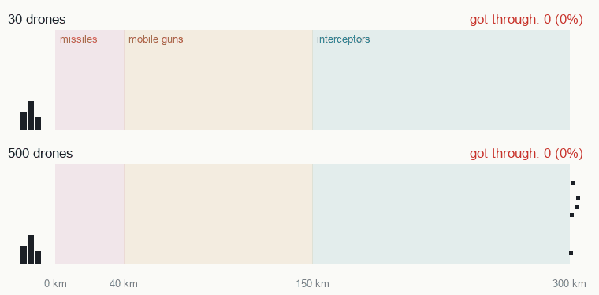

# Jomini

[](https://github.com/umitkaanusta/Jomini/actions/workflows/ci.yml)
[](LICENSE)

**Simulate battles from the musket to the drone.**

Jomini provides models of attrition and escalation, and lets you fit them to historical
battles and, where data exists, to wars still being fought.

It also runs as an [MCP server for your AI agents](#use-it-from-claude). The Python package
on PyPI is out of date; I'll update it once my PyPI account is unblocked.

We don't celebrate or glorify war or any other violence. Jomini is for studying how wars
are fought today and how they were fought in the past.

## Simulating a drone raid



Two night-time drone raids on a city defended by three rings: interceptor drones, mobile
gun teams and surface-to-air missiles. The model comes from Randow et al. (2026). We
fitted it to the Ukrainian Air Force's nightly reports from September 2024 to November
2026. A quarter of the 30-drone raid gets through. Of the 500-drone raid, less than a tenth
does.

### How it's done

```python
from jomini.airdefense import ukraine_defense

defense = ukraine_defense()  # the defence fitted to Ukraine's reports
print(defense.raid(30))
# 30 launched, 7.2 leaked (24.0%); interceptors 17 kills/27 shots,
# mobile guns 3 kills/11 shots, missiles 3 kills/3 shots
print(defense.raid(500))
# 500 launched, 43.8 leaked (8.8%); interceptors 376 kills/596 shots,
# mobile guns 50 kills/157 shots, missiles 30 kills/34 shots
```

Or bring your own equipment:

```python
from jomini.airdefense import AirDefense, Layer

drones = Layer("interceptor drones", 300, 150, pk=0.6, fire_rate=60, engage_rate=2, magazine=300)
guns = Layer("mobile guns", 150, 40, pk=0.3, fire_rate=100, engage_rate=2)
patriot = Layer("Patriot", 40, 0, pk=0.85, fire_rate=20, engage_rate=2, magazine=60)
defense = AirDefense((drones, guns, patriot))

defense.raid(300).leak_fraction  # 0.69: this defence is swamped

nights = defense.campaign([300] * 10, restock={"Patriot": 4, "interceptor drones": 30})
nights.empty_after("Patriot")  # 3: the Patriots run out of missiles after night four
```

### The equations

Each ring is one kind of equipment, with its own range, chance to kill, rate of fire,
stock of ammunition and cost per shot. In the demo:

```
city <-- missiles --|-- mobile guns --|-- interceptor drones --|<-- raid
0 km              40 km            150 km                   300 km
```

Let $u(x, t)$ be the number of drones per kilometre at distance $x$ from the city. They
fly in at speed $v$ and spread out as they go. Ring $k$ kills them at rate $h_k$:

```math
\frac{\partial u}{\partial t} = v\,\frac{\partial u}{\partial x} + D\,\frac{\partial^2 u}{\partial x^2} - \sum_k h_k\,\mathbf{1}[x \in \text{ring } k]\,u
```

Ring $k$ has $N_k$ drones inside it and fires $s_k$ shots an hour, until its stock $M_k$
runs out:

```math
N_k = \int_{\text{ring } k} u\,dx, \qquad
s_k = \frac{F_k\,e_k\,N_k}{F_k + e_k\,N_k}, \qquad
h_k = \frac{p_k\,s_k}{N_k}, \qquad
\frac{dM_k}{dt} = -s_k
```

When a big raid is coming, the defence can be reinforced. For a raid of $R$ drones, $F_k$
and $e_k$ are multiplied by $(R/100)^{\sigma}$. Drones that reach $x = 0$ get through.

| Symbol | Meaning |
|---|---|
| $v$ | Drone speed (185 km/h) |
| $D$ | How fast the raid spreads out (50 km²/h) |
| $p_k$ | Chance that one shot kills |
| $e_k$ | How often a lone drone is shot at (shots per hour) |
| $F_k$ | The most shots the ring can fire in an hour |
| $M_k$ | Shots left in stock |
| $\sigma$ | Surge: how much the defence is reinforced for big raids |

### What it means

- **Few drones:** every drone runs the same risk, $h_k = p_k e_k$. Numbers don't help the
  attacker.
- **Many drones:** the ring fires flat out, so each drone's risk falls as $p_k F_k / N_k$.
  Numbers swamp the defence.

So a defence that can't reinforce lets a bigger share through as raids grow. If big raids
leak a smaller share, the defence must be reinforcing ($\sigma > 0$).

### Fitted to Ukraine's data

Each night the Ukrainian Air Force reports how many drones were launched and how many
were stopped. Jomini downloads these reports, compiled by Petro Ivaniuk, when you use
them. The fit uses 778 nights with at least five drones launched, and compares each night
with the typical raid that month (125 drones).

| Parameter | Estimate |
|---|---|
| Chance one shot kills (drones, guns, missiles) | 0.63, 0.32, 0.90 |
| Surge, $\sigma$ | 0.19: when a raid doubles, each drone is shot at 14% more often |
| Most shots per hour, $F_k$ | never reached on a typical night |
| Stock, $M_k$ | doesn't run out within a night |

| Raid size | Got through (data) | Model |
|---|---|---|
| ¼ of typical | 16.5% | 23.5% |
| ½ | 19.7% | 19.2% |
| typical | 16.1% | 15.5% |
| 2× | 11.2% | 11.9% |
| 4× | 8.5% | 8.5% |

The model is off by 1.5 percentage points on average, and too high on the smallest
raids. Before autumn 2024 big raids did not leak a smaller share.

Two warnings. The reports say only how many drones were stopped, not which ring stopped
them, so only overall lethality and surge are really estimated; the split between rings is
a guess. And these are Ukraine's own figures, which count decoys that never arrive as
stopped.

`scripts/fit_ukraine_defense.py` reproduces the fit. `scripts/make_raid_gif.py` draws the
animation.

## What it lacks

- **Space.** No maps, terrain or routes. The raid model knows only how far each drone is
  from its target.
- **Everything but attrition.** No manoeuvre, morale, command, supply or weather, except
  that a side can break after heavy losses.
- **Real orders of battle.** Ranges, weapon numbers and costs are placeholders.
- **Decoys and jamming.** They show up only as drones that never arrive.
- **Forecasts.** The fits describe what happened. They don't predict what will.

## Other models

- **Escalation:** how much violence in a war feeds on itself, from UCDP's 418,000 events
  since 1989. In Russia–Ukraine each event sets off 0.69 more on average; in Sudan, 0.23.
- **Effectiveness over time:** how many losses each side takes for each enemy loss, period
  by period, from Oryx's photo-confirmed equipment losses.
- **Historical battles:** 660 land battles from 1600 to 1982 with strengths, losses,
  commanders and a written account of each. Fit attrition models to them, find what made
  armies deadlier, and estimate each side's chance of winning.
- **Missile exchanges:** Hughes' salvo model for fleets and missile duels.

## Use it from Claude

Jomini can run as an MCP server, so Claude and other AI agents can use the models and data
directly.

**Claude Code:**

```bash
claude mcp add jomini -- uvx --from "jomini[mcp] @ git+https://github.com/umitkaanusta/Jomini" jomini-mcp
```

**Claude Desktop** (`claude_desktop_config.json`):

```json
{
  "mcpServers": {
    "jomini": {
      "command": "uvx",
      "args": ["--from", "jomini[mcp] @ git+https://github.com/umitkaanusta/Jomini", "jomini-mcp"]
    }
  }
}
```

| Tool | What it does |
|---|---|
| `air_defense_raid` | Run drone raids against the Ukraine-fitted defence or one you design, for one night or many |
| `air_defense_saturation_test` | Check Ukraine's nightly reports: do bigger raids leak a bigger share? |
| `conflict_events` | Monthly events and deaths for any conflict or country since 1989 |
| `escalation_model` | How strongly violence in a conflict feeds on itself |
| `effectiveness_trend` | How each side's effectiveness changed over time |
| `get_loss_series`, `loss_intensity` | Daily and smoothed losses: Kursk, Ukrainian General Staff, Oryx |
| `search_battles`, `get_battle` | Find a historical battle and read its full record |
| `fit_battle`, `what_if`, `simulate_battle` | Measure each side in a battle, and refight it with changes |
| `compare_effectiveness`, `combat_power` | How deadly an army was, and what made it so |
| `estimate_law`, `fit_law_to_series` | Fit attrition models to groups of battles or to loss series |
| `breakpoint_distribution` | How much loss an army takes before it breaks |
| `salvo_exchange` | Missile and drone exchanges |
| `list_datasets`, `cite` | Every dataset's coverage, licence and caveats, and BibTeX |

Every answer lists the sources it used, and `cite` turns them into BibTeX.

## Sources

| Dataset | Licence | |
|---|---|---|
| CDB90: CAA Database of Battles | CC0 1.0 (data); MIT (code) | ships with Jomini |
| Battle of Kursk, southern front, daily | Public domain (U.S. Government work, 17 U.S.C. 105) | ships with Jomini |
| American Civil War battles (Livermore 1900) | Public domain (1900); transcription ODC-BY 1.0 | ships with Jomini |
| UCDP Georeferenced Event Dataset 26.1 | CC BY 4.0 | downloaded when used |
| UCDP Candidate GED (provisional, current year) | CC BY 4.0 | downloaded when used |
| Russian losses claimed by Ukraine's General Staff | MIT (compilation) | downloaded when used |
| Oryx visually confirmed equipment losses (weekly) | CC BY 4.0 (compilation) | downloaded when used |
| Oryx confirmed losses by event date (both sides) | MIT (compilation) | downloaded when used |
| Russian drone and missile raids on Ukraine (nightly) | CC BY-NC-SA 4.0 (non-commercial; not bundled) | downloaded when used |

<details>
<summary>Papers and books</summary>

- Lanchester, Frederick W. (1916). *Aircraft in Warfare: The Dawn of the Fourth Arm*. Constable.
- Bracken, Jerome (1995). *Lanchester Models of the Ardennes Campaign*. Naval Research Logistics.
- Helmbold, Robert L. (1964). *Some Observations on the Use of Lanchester's Theory for Prediction*. Operations Research.
- Helmbold, Robert L. (1971). *Decision in Battle: Breakpoint Hypotheses and Engagement Termination Data*. RAND Corporation.
- Hartley, Dean S., III (1995). *A Mathematical Model of Attrition Data*. Naval Research Logistics.
- Fricker, Ronald D., Jr. (1998). *Attrition Models of the Ardennes Campaign*. Naval Research Logistics.
- Lucas, Thomas W.; Turkes, T. (2004). *Fitting Lanchester Equations to the Battles of Kursk and Ardennes*. Naval Research Logistics.
- Hughes, Wayne P., Jr. (1995). *A Salvo Model of Warships in Missile Combat Used to Evaluate Their Staying Power*. Naval Research Logistics.
- Dupuy, Trevor N. (1979). *Numbers, Predictions and War: Using History to Evaluate Combat Factors and Predict the Outcome of Battles*. Bobbs-Merrill.
- Rotte, Ralph; Schmidt, Christoph M. (2003). *On the Production of Victory: Empirical Determinants of Battlefield Success in Modern War*. Defence and Peace Economics.
- Brunton, Steven L.; Proctor, Joshua L.; Kutz, J. Nathan (2016). *Discovering Governing Equations from Data by Sparse Identification of Nonlinear Dynamical Systems*. Proceedings of the National Academy of Sciences. https://doi.org/10.1073/pnas.1517384113
- Rauch, H. E.; Tung, F.; Striebel, C. T. (1965). *Maximum Likelihood Estimates of Linear Dynamic Systems*. AIAA Journal.
- (2024). *Analyzing Russia–Ukraine War Patterns Based on Lanchester Model Using SINDy Algorithm*. Mathematics. https://doi.org/10.3390/math12060851
- Hawkes, Alan G. (1971). *Spectra of Some Self-Exciting and Mutually Exciting Point Processes*. Biometrika.
- Lewis, Erik; Mohler, George; Brantingham, P. Jeffrey; Bertozzi, Andrea L. (2012). *Self-Exciting Point Process Models of Civilian Deaths in Iraq*. Security Journal.
- Browning, Raiha; Patten, Hamish; Rousseau, Judith; Mengersen, Kerrie (2024). *Bayesian Spatiotemporal Modelling of Political Violence and Conflict Events Using Discrete-Time Hawkes Processes*. arXiv:2408.14940.
- Sundberg, Ralph; Melander, Erik (2013). *Introducing the UCDP Georeferenced Event Dataset*. Journal of Peace Research.
- Davies, Shawn; Pettersson, Therése; Öberg, Magnus (2026). *Organized Violence 1989–2025, and Violent Political Protests*. Journal of Peace Research. https://doi.org/10.1093/jopres/xjag046
- U.S. Army Concepts Analysis Agency (1991). *Database of Battles, Version 1990 (CDB90)*. U.S. Army Concepts Analysis Agency.
- Arnold, Jeffrey B. (2026). *CDB90 Battle Dataset (release 10.8.0)*. https://github.com/jrnold/CDB90. https://doi.org/10.5281/zenodo.23928303
- Livermore, Thomas L. (1900). *Numbers and Losses in the Civil War in America, 1861–65*. Houghton, Mifflin and Company.
- Arnold, Jeffrey B. (n.d.). *American Civil War Battle Data*. https://github.com/jrnold/acw_battle_data. https://doi.org/10.6084/m9.figshare.1515995
- Ivaniuk, Petro (n.d.). *2022 Ukraine–Russia War Dataset*. https://github.com/PetroIvaniuk/2022-Ukraine-Russia-War-Dataset.
- Oryx (n.d.). *Attack on Europe: Documenting Equipment Losses During the Russian Invasion of Ukraine*. https://www.oryxspioenkop.com/.
- Scarnecchia, Daniel (n.d.). *oryx_data*. https://github.com/scarnecchia/oryx_data.
- Drake, Lee (n.d.). *Russia-Ukraine*. https://github.com/leedrake5/Russia-Ukraine.
- Randow, Charles; Allaire, Ryan H.; Mastroberardino, Antonio (2026). *Modeling Drone Swarms with a PDE Extension of Lanchester's Laws*. The Journal of Defense Modeling and Simulation. https://doi.org/10.1177/15485129261436073
- Holling, C. S. (1959). *Some Characteristics of Simple Types of Predation and Parasitism*. The Canadian Entomologist.
- Ivaniuk, Petro (n.d.). *Massive Missile Attacks on Ukraine*. https://www.kaggle.com/datasets/piterfm/massive-missile-attacks-on-ukraine.

</details>

## Development

```bash
uv sync --all-extras
uv run pytest
uv run ruff check && uv run ruff format --check && uv run mypy
```

## License

MIT
